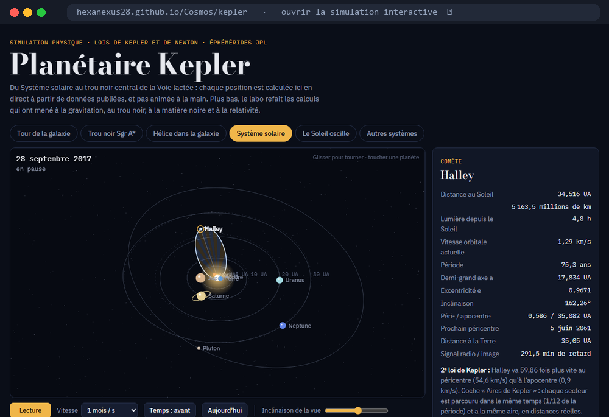

<h1 align="center">Cosmos</h1>

<p align="center">
  <strong>Refaire les calculs de la cosmologie sur des données publiques, avant de les interpréter.</strong><br>
  Un carnet de recherche : questions ouvertes, calculs reproductibles, paris chiffrés.
</p>

<p align="center">
  <a href="https://hexanexus28.github.io/Cosmos/kepler/"></a>
</p>

<p align="center"><sub>Chapitre 0 : <a href="https://hexanexus28.github.io/Cosmos/kepler/">Planétaire Kepler</a>, une simulation dont chaque position est calculée en direct.</sub></p>

## Pourquoi Cosmos

- **Valider avant d'interpréter.** Un calcul n'est lu qu'après avoir retrouvé une valeur publiée. Sur les données de
  DESI DR2, la chaîne redonne Ωm = 0,2972 (publié : 0,2975 ± 0,0086) ; sur Pantheon+, 0,331 (publié : 0,334 ± 0,018) ;
  sur le fond diffus, H₀ = 67,33 (Planck : 67,4 ± 0,5).
- **Des résultats chiffrés, à côté des valeurs publiées.** L'énergie noire évolue-t-elle ? Avec les seules mesures
  BAO, la préférence est de 1,7 σ ; avec le fond diffus compressé, 2,4 σ (DESI publie 3,1 σ) ; en y ajoutant Pantheon+,
  2,3 σ (DESI : 2,8 σ).
- **Tester ce qui pourrait fabriquer le signal.** Sur les systématiques officielles de Pantheon+ (10 des 14 testées, en
  cours), aucune seule ne fabrique la préférence ni ne l'efface : elle reste entre 1,70 et 2,84 σ. Les trois qui comptent
  sont l'étalonnage, le modèle SALT2 et la poussière galactique.
- **Parier avec un chiffre.** Chaque pari porte une probabilité et ce qui le ferait réviser. Il se révise par une
  nouvelle entrée datée, jamais en réécrivant l'ancienne.
- **Reproductible.** Les scripts refont les calculs depuis les données publiques, retéléchargeables ; les résultats sont
  versionnés.

## Les questions

| Question | Statut |
|---|---|
| Q1 : l'énergie noire évolue-t-elle ? Survit-elle à d'autres supernovas, au retrait du fond diffus, à un autre paramétrage ? | en cours |
| Q2 : d'où vient la tension sur H₀ ? | ouverte |
| Q3 : pourquoi le vide pèse-t-il si peu ? | ouverte |
| Q5 : la profondeur optique τ explique-t-elle la préférence de DESI ? | ouverte |
| Q9 : une seule systématique de Pantheon+ peut-elle fabriquer ou effacer le signal ? | en cours |

Le détail est dans [carnet/questions.md](carnet/questions.md), le registre des paris dans
[carnet/paris.md](carnet/paris.md) et l'historique dans [carnet/journal.md](carnet/journal.md).

## Une démarche à deux voix

Ce carnet est mené en binôme : l'auteur et un assistant IA (Claude). Les positions de chacun sont distinguées dans les
paris et les désaccords ([carnet/desaccords.md](carnet/desaccords.md)), et les règles de travail sont écrites dans
[CLAUDE.md](CLAUDE.md) : séparer les faits, les tensions et les paris, citer des sources récentes, valider avant
d'interpréter.

## Lancer les calculs

Prérequis : Python 3.

```bash
py -3 -m venv .venv
.venv/Scripts/python -m pip install -r calculs/requirements.txt
bash calculs/telecharger_donnees.sh
PYTHONIOENCODING=utf-8 .venv/Scripts/python calculs/ajustement_bao_sn.py
```

`PYTHONIOENCODING=utf-8` évite un plantage de la console Windows sur les caractères Ω et χ. Les données (DESI DR2 BAO,
Pantheon+) sont retéléchargées dans `calculs/data/`, qui n'est pas versionné.

## Structure du dépôt

| Dossier | Contenu |
|---|---|
| `carnet/` | questions, paris, journal, désaccords, lexique |
| `calculs/` | scripts Python et `resultats/` (versionnés) |
| `lectures/` | fiches d'articles : ce qu'ils mesurent, comment, leurs points faibles |
| `kepler/` | la simulation Planétaire Kepler (page autonome) |
| `artefact/` | `cosmos.html`, compagnon interactif des résultats ; il lit la base de l'artefact d'origine et s'affiche hors ligne ici |
| `docs/images/` | logo et aperçu |

## Sources

- DESI DR2 BAO : [CobayaSampler/bao_data](https://github.com/CobayaSampler/bao_data/tree/master/desi_bao_dr2)
- Pantheon+ : [PantheonPlusSH0ES/DataRelease](https://github.com/PantheonPlusSH0ES/DataRelease)
- Fond diffus compressé : [Chen, Huang & Wang 2019](https://arxiv.org/abs/1808.05724), table I (Planck 2018, cas ΛCDM)

## Licence

Code sous licence [MIT](LICENSE).
